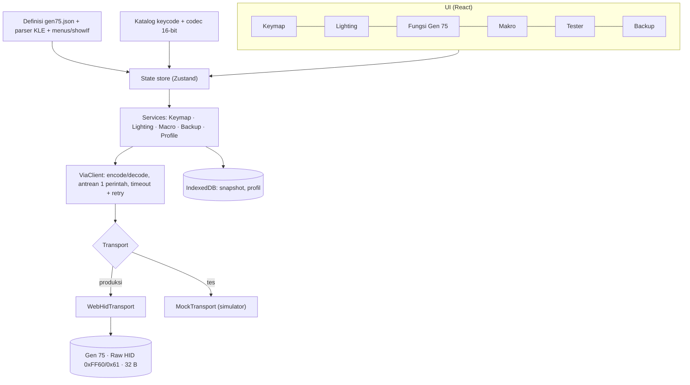

# Rancangan Software App: ElecFox Gen 75

**Nama kerja:** Gen75 Studio (sengaja tidak memakai kata "ElecFox" agar tidak tampak sebagai produk resmi pabrikan)
**Status:** draf v0.1 · 2026-11-07
**Dasar rancangan:** berkas proyek (`GEN 75.JSON`, `gen75.bin`), dokumentasi VIA di caniusevia.com, dan spesifikasi QMK/VIA yang diketahui.
**Prototipe UI:** [`prototype/index.html`](prototype/index.html) (buka langsung di Chrome/Edge; tidak terhubung ke keyboard).

Tingkat keyakinan setiap klaim:

| Tanda | Arti |
|---|---|
| [V] | Terverifikasi langsung dari berkas proyek |
| [D] | Dari dokumentasi VIA/QMK atau pengetahuan umum; belum dicek pada perangkat |
| [A] | Asumsi atau dugaan; harus diuji pada perangkat sebelum dijadikan fitur |

---

## 0. Ringkasan keputusan

1. **Bentuk app: web app (PWA) berbasis WebHID**, mirip usevia.app tetapi khusus Gen 75. Definisi papan sudah tertanam, jadi pengguna tidak perlu memuat JSON manual atau menyalakan tab Design.
2. **Protokol: tetap memakai protokol VIA di atas Raw HID.** Firmware sudah memilikinya [V] (usage page `0xFF60`, usage `0x61`, report 32 byte). Fase awal tidak membutuhkan perubahan firmware.
3. **Nilai tambah dibanding VIA:** pemetaan cepat fungsi khas Gen 75 (2.4G/BLE1-3/USB, Win-lock, NKRO, dll.), backup/restore dan profil, editor makro yang lebih nyaman, tester dengan heatmap, validasi lebih ketat sebelum menulis, antarmuka Bahasa Indonesia.
4. **Batasan yang harus diterima:** konfigurasi hampir pasti **hanya lewat kabel USB** [A], dan **membaca baterai/mode aktif tidak ada di protokol VIA standar**. Dua hal ini baru jelas setelah Fase 0.
5. **Flashing firmware tidak masuk MVP.** Bootloader belum teridentifikasi dan risiko merusak papan tinggi.
6. **Urutan kerja:** Fase 0 probe perangkat read-only (3-5 hari kerja) → Fase 1 MVP (keymap, lighting, backup) → Fase 2 (makro, tester, panel perangkat) → Fase 3 (profil, desktop/flashing bila memungkinkan).

---

## 1. Fakta perangkat

| Item | Nilai | Sumber |
|---|---|---|
| Nama di definisi | `GEN 75` | [V] JSON |
| USB VID:PID | `0x36B0 : 0x3077` | [V] JSON dan [V] device descriptor di `gen75.bin` (offset 73.274) |
| Matriks | 6 baris × 16 kolom = 96 slot; **83 posisi dipakai** (82 tombol + tombol tekan knob), 13 slot kosong | [V] JSON |
| Layout fisik | 75% ANSI; baris F + knob kanan atas; kolom kanan Del/PgUp/PgDn/Home/End; panah terpisah | [V] JSON |
| Lighting | RGB matrix QMK (channel 3), **45 efek** (+ opsi `none`; total 46 entri), brightness **0-160**, speed 0-255, color picker | [V] JSON |
| Keycode kustom | 11: `2.4G, BLE1, BLE2, BLE3, USB, BAT, WLO, SIX_N, FN_ALT, RTOG, U_EE_CLR` | [V] JSON |
| Berkas firmware | `gen75.bin`, 76.304 byte, tabel vektor ARM Cortex-M di offset 0, **tidak terenkripsi** (entropi 6,8 bit/byte, normal untuk kode biasa) | [V] bin |
| USB device descriptor | USB 2.0, EP0 64 B, bcdDevice 0.02, 1 konfigurasi | [V] bin |
| String USB | Manufacturer `RDMCTMZT`, Product `Gaming keyboard` (bukan "GEN 75") | [V] bin |
| Antarmuka HID | Keyboard (boot), **Raw HID `0xFF60/0x61`, in/out masing-masing 32 B, tanpa Report ID**, Mouse, dan Keyboard kedua (kemungkinan jalur NKRO) | [V] bin |
| Jumlah layer, slot makro, ukuran buffer makro, dukungan encoder | belum diketahui, dibaca saat runtime (default VIA/QMK: 4 layer) | [A] |
| Bootloader | tidak teridentifikasi (tidak ada string QMK/DFU/bootloader di image) | [A] |

Catatan: pencarian web tidak menemukan halaman produk publik "ElecFox Gen 75" (yang terdekat: ELECFOX INKY75). Karena itu spesifikasi di atas dibangun dari berkas proyek, bukan dari brosur pabrikan.

### Konsekuensi desain dari temuan ini

- Perangkat dikenali lewat **VID/PID + usage Raw HID**, bukan lewat nama. Filter WebHID: `{ vendorId: 0x36B0, productId: 0x3077, usagePage: 0xFF60, usage: 0x61 }`.
- Koleksi keyboard dan mouse di perangkat ini tidak bisa dibuka WebHID (diblokir browser), tetapi koleksi Raw HID vendor-defined bisa [D]. Itu satu-satunya yang dibutuhkan.
- Report tanpa Report ID: pakai `sendReport(0, data32)` dan baca `inputreport` dengan `reportId === 0`.

---

## 2. Temuan pada `GEN 75.JSON`

| # | Temuan | Dampak | Saran |
|---|---|---|---|
| 1 | `GEN 75.JSON` dan `GEN 75 (1).JSON` identik (hash SHA-256 sama) | tidak ada | hapus satu |
| 2 | Opsi layout **"Caps Lock"** (toggle) hanya punya pilihan 0 (`3,0\n\n\n0,0`); tidak ada tombol untuk pilihan 1 | dokumentasi VIA mewajibkan setiap pilihan menutupi area yang sama, dan tidak menjelaskan apa yang terjadi bila tombol pilihan 1 tidak ada; kemungkinan tombol Caps hilang saat opsi dinyalakan [A] | hapus `layouts.labels` atau tambahkan varian tombolnya |
| 3 | Knob `0,15` memakai koordinat matriks `0,15` plus label tengah ` e0 ` (dengan spasi di sekitarnya) | [V] pola ini sesuai dokumentasi VIA untuk encoder **dengan tombol tekan** (`e0` = encoder indeks 0). Putaran baru bisa di-remap bila firmware memakai `ENCODER_MAP_ENABLE` dengan encoder map [A]; spasi di sekitar `e0` mungkin perlu dihapus bila tidak di-trim | Fase 0: baca `dynamic_keymap_get_encoder` (`0x14`); bila gagal, putaran tidak bisa diubah |
| 4 | Brightness dibatasi `0-160` (standar QMK 0-255) | kemungkinan sengaja (batas arus/baterai) | app harus membaca batas dari definisi, bukan hardcode |
| 5 | Panah kanan (`5,15`) di x = 15,25u, sedangkan kolom kanan (End, dll.) di x = 15,5u | selisih 0,25u di kanvas; kosmetik | cocokkan dengan papan fisik |
| 6 | Posisi matriks tidak berurutan (mis. `2,14` di baris F, `3,14` di baris Tab) | normal untuk PCB nyata | tester/heatmap wajib memakai peta dari definisi, jangan asumsi urut |

---

## 3. Tujuan, non-tujuan, pengguna

**Tujuan**

- G1. Remap semua tombol di semua layer, aman, dengan undo/redo.
- G2. Kendali lighting penuh sesuai definisi (45 efek, brightness, speed, warna).
- G3. Akses mudah ke 11 keycode khas Gen 75.
- G4. Backup/restore dan profil yang bisa dibagikan.
- G5. Tanpa instalasi; jalan di Chrome/Edge; tetap bisa dibuka offline (PWA).
- G6. **Tidak pernah merusak keyboard**: kebijakan penulisan ketat (bagian 11).

**Non-tujuan v1**

- Flashing firmware, atau mengubah firmware.
- Editor RGB per-tombol ([A] firmware tampaknya hanya mendukung efek; belum dipastikan).
- Aplikasi ponsel; sinkronisasi cloud; akun pengguna.
- Makro yang dijalankan di sisi PC (berbeda dari makro yang tersimpan di keyboard).

**Pengguna:** (1) pemilik sekaligus pengembang (power user); (2) pembeli Gen 75 lain bila app dibagikan (non-teknis; butuh bahasa sederhana dan peringatan jelas).

---

## 4. VIA: apa yang dipakai, apa yang dibenahi

Yang terverifikasi dari dokumentasi VIA (caniusevia.com):

- Web app yang mengonfigurasi keyboard QMK saat runtime; keyboard dideskripsikan oleh **definisi JSON** (layout fisik, opsi layout, elemen yang bisa dikonfigurasi).
- Definisi **v3** (protokol VIA 11 atau lebih baru) memakai `menus` (menu bawaan seperti `qmk_rgb_matrix` atau UI kustom) dan `showIf`; `customKeycodes` hanya memberi **label** pada `CUSTOM(n)`, implementasinya ada di firmware.
- Key tester (kini dengan suara), makro dengan delay dan indikator memori (delay butuh firmware kompatibel), mode tampilan 3D/2D, tema, draf di tab Design yang bertahan antar sesi. Aplikasi desktop lama dinyatakan deprecated; web app adalah jalur yang didukung. WebHID adalah transport yang dipakai.
- **Gen 75 tidak ada di daftar keyboard resmi VIA** (daftar bertanggal 19/9/2026; pencarian "elecfox", "gen 75", "gen75" tidak menemukan apa pun). Definisi buatan pabrikan dimuat lewat *sideload* di tab Design.
- Pengaturan VIA mencakup tampilan slider (hanya slider / dengan nilai / dengan kolom input), tab HID Console (butuh `CONSOLE_ENABLE` di firmware), dan antarmuka dalam 6 bahasa (Inggris, Mandarin, Korea, Jepang, Spanyol, Jerman). **Bahasa Indonesia tidak termasuk.**
- Dukungan encoder di VIA: perlu `ENCODER_MAP_ENABLE` di `rules.mk` dan encoder map per layer di firmware.

Peluang untuk Gen 75 (tidak berarti VIA pasti tidak punya; beberapa perlu dicek):

| Peluang | Alasan |
|---|---|
| Definisi tertanam | Gen 75 tidak ada di daftar resmi, jadi di VIA pengguna harus sideload JSON lewat tab Design; di app ini cukup klik "Sambungkan" |
| Panel fungsi Gen 75 | Di VIA, `2.4G`/`BLE1` hanya label tombol tanpa konteks; app bisa menjelaskan dan memasangkannya dengan satu klik |
| Backup dan profil | Memudahkan eksperimen tanpa takut kehilangan keymap |
| Validasi dan keselamatan | Tolak keycode di luar jangkauan, snapshot otomatis, kunci perintah berbahaya |
| Bahasa Indonesia | VIA tidak menyediakannya; penjelasan dan peringatan dalam bahasa pengguna |

---

## 5. Keputusan platform

| Opsi | Akses HID | Flashing firmware | Instalasi/update | Usaha | Catatan |
|---|---|---|---|---|---|
| **Web PWA (WebHID)** ← rekomendasi | Raw HID ya | tidak | tanpa instalasi, update instan | rendah | hanya Chrome/Edge/Opera [D]; butuh HTTPS atau localhost; `requestDevice` harus dipicu klik |
| Desktop (Tauri/Electron) | penuh | mungkin | installer + auto-update | sedang | baru berguna bila flashing dibutuhkan |
| Native (C#/WinUI) | penuh | mungkin | installer | tinggi | hanya Windows |

**Rekomendasi:** web PWA dulu; bungkus dengan Tauri **hanya bila** Fase 0 menunjukkan jalur flashing yang aman. Seluruh logika (`core/`) ditulis tanpa ketergantungan pada browser agar bisa dipakai ulang.

---

## 6. Fitur dan prioritas

| ID | Fitur | Prioritas | Fase |
|---|---|---|---|
| F01 | Koneksi USB (WebHID), auto-reconnect, status jelas | Must | 1 |
| F02 | Baca seluruh keymap semua layer | Must | 1 |
| F03 | Kanvas layout dirender dari definisi (KLE) | Must | 1 |
| F04 | Pemilih keycode: kategori, pencarian, kolom "Any" (hex) | Must | 1 |
| F05 | Edit tombol: klik, multi-pilih, undo/redo | Must | 1 |
| F06 | Layer: jumlah dari firmware, tab layer, salin/reset layer | Must | 1 |
| F07 | Lighting: render menu v3 dari definisi (termasuk `showIf`) | Must | 1 |
| F08 | Backup/restore JSON + snapshot otomatis | Must | 1 |
| F09 | Keycode khas Gen 75 (11 item) dengan deskripsi | Must | 1 |
| F10 | Panel "Fungsi Gen 75": pasang cepat ke tombol, panduan penggunaan | Should | 2 |
| F11 | Makro: rekam, editor skrip, indikator memori | Should | 2 |
| F12 | Key tester berbasis `switch_matrix_state` (heatmap) | Should | 2 |
| F13 | Profil bernama, tukar cepat, ekspor/impor | Should | 3 |
| F14 | Pemetaan putaran knob (bila firmware mendukung) | Should | 2 |
| F19 | Impor/ekspor kompatibel format simpan/muat VIA | Should | 2 |
| F15 | Indikator baterai dan mode aktif | Could | bergantung firmware |
| F16 | Tema, i18n ID/EN, label Mac | Could | 2 |
| F18 | Diff antar keymap/profil | Could | 3 |
| F17 | Flashing firmware | Won't (v1) | 3 bila memungkinkan |

---

## 7. Rancangan UI/UX

### 7.1 Navigasi

Sidebar: **Keymap · Lighting · Fungsi Gen 75 · Makro · Tester · Profil · Bandingkan · Backup · Setelan**. Profil, Bandingkan, dan Setelan tetap bisa dibuka tanpa keyboard.
Bilah atas: status koneksi (nama, VID:PID, versi protokol), Undo/Redo, profil aktif.

```
┌────────────────────────────────────────────────────────────────────────────┐
│ ● GEN 75 · USB · 36B0:3077 · protokol N        [↶][↷]   Profil: Harian ▾  │
├─────────┬──────────────────────────────────────────────────────────────────┤
│ Keymap  │ Layer: [0] [1] [2] [3]        [ ] Label Mac  [ ] Koordinat      │
│ Lighting│ ┌──────────────────────────────────────────────────────────────┐ │
│ Fungsi  │ │ Esc F1 F2 F3 F4 F5 F6 F7 F8 F9 F10 F11 F12   Del   (●)       │ │
│ Makro   │ │ `  1  2  3  4  5  6  7  8  9  0  -  =  ⌫⌫    PgUp           │ │
│ Tester  │ │ Tab Q  W  E  R  T  Y  U  I  O  P  [  ]  \     PgDn           │ │
│ Backup  │ │ Caps A  S  D  F  G  H  J  K  L  ;  '  Enter    Home         │ │
│ Setelan │ │ Shift Z  X  C  V  B  N  M  ,  .  /  Shift ↑    End          │ │
│         │ │ Ctrl Win Alt   Space   Alt Fn Ctrl      ←  ↓  →              │ │
│         │ └──────────────────────────────────────────────────────────────┘ │
│         │ Terpilih: matriks 0,13 · keycode KC_BSPC                         │
│         │ ┌ Dasar │ Layer │ Media │ Gen 75 │ Lampu │ Makro ┐  cari         │
│         │ │ [A][B][C][D] ...                                              │
└─────────┴──────────────────────────────────────────────────────────────────┘
```

### 7.2 Model penyuntingan

Tulis **langsung ke perangkat** per perubahan (seperti VIA), dilengkapi:
- snapshot otomatis saat terhubung (disimpan 10 terakhir di IndexedDB),
- undo/redo 50 langkah,
- baca-ulang (read-back) setiap penulisan untuk memastikan berhasil.

Tidak memakai mode "staging + Terapkan": kerumitan diff tidak sebanding karena setiap perubahan sudah bisa dibatalkan.

### 7.3 Spesifikasi per layar

| Layar | Isi utama | Keadaan khusus |
|---|---|---|
| **Sambungkan** | Penjelasan singkat, tombol "Sambungkan keyboard" (gestur klik wajib), daftar syarat (kabel USB, Chrome/Edge) | browser tidak mendukung WebHID; izin ditolak; perangkat tidak ditemukan; mode nirkabel terdeteksi (tidak ada Raw HID) |
| **Keymap** | Kanvas layout, tab layer, palet keycode, panel detail tombol, multi-pilih (Shift/seret) | layer baru kosong; keycode tak dikenal ditampilkan sebagai hex; tombol knob ditandai khusus |
| **Lighting** | Menu dibangun otomatis dari `menus` definisi: Brightness, Effect (45 + none), Speed, Color; pratinjau kanvas | `showIf` menyembunyikan Speed/Color sesuai efek; slider dibatasi 0-160 |
| **Fungsi Gen 75** | 11 keycode dikelompokkan (Mode koneksi, Fungsi, Berbahaya), tombol "Pasang ke tombol...", kartu status (baterai/mode: "butuh dukungan firmware") | `U_EE_CLR` diberi peringatan merah dan konfirmasi |
| **Makro** | Slot makro, editor aksi (tap/down/up/jeda/teks), perekam, indikator memori | memori penuh; makro tanpa aksi; delay tak didukung firmware |
| **Tester** | Heatmap kanvas dari `switch_matrix_state`, penghitung tombol teruji, reset | firmware tak mendukung matrix state → fallback ke event keyboard browser (Fn dan knob tidak terdeteksi) |
| **Backup** | Unduh/muat backup, daftar snapshot, pulihkan | berkas tidak cocok VID/PID/matriks → ditolak dengan alasan jelas |
| **Setelan** | Tema, bahasa, label Mac, tampilkan koordinat matriks, "Mode pengembang" (hex, log HID) | - |

### 7.4 Prinsip UX

- Kanvas keyboard adalah pusat; semua panel pendukung bersifat sekunder.
- Setiap aksi berisiko memakai kata kerja spesifik ("Hapus semua pengaturan keyboard"), bukan "OK".
- Pesan galat menjelaskan **apa yang terjadi, dampaknya, dan langkah berikutnya**.
- Navigasi penuh dengan keyboard; fokus terlihat; kontras minimal WCAG AA; hormati `prefers-reduced-motion`.
- Lebar minimum 1024 px untuk editor; di bawah itu tampilkan mode baca/uji tanpa penyuntingan.

---

## 8. Arsitektur



### 8.1 Tumpukan teknologi

| Lapisan | Rencana | Dipakai di Fase 1 |
|---|---|---|
| Bahasa | TypeScript (strict) | sama; protokol biner rawan salah, tipe membantu |
| Build | Vite + `vite-plugin-pwa` | Vite saja; PWA/offline ditunda ke Fase 2 |
| UI | React 18, Tailwind CSS, Radix UI | React 18 dengan CSS biasa dan elemen HTML bawaan (`dialog`, `fieldset`); cukup untuk skala ini |
| State | Zustand | sama (`zustand/vanilla` agar store bisa diuji tanpa DOM) |
| Validasi | zod | validasi manual di `backup.ts` dan `definition/`, dengan pesan galat berbahasa Indonesia |
| Penyimpanan | `idb` (IndexedDB) | IndexedDB langsung; jatuh ke memori bila tidak tersedia |
| Uji | Vitest, Playwright | Vitest untuk inti dan store, dengan perangkat simulasi; E2E Playwright belum |
| i18n | i18next | belum; teks masih Bahasa Indonesia saja |

### 8.2 Struktur repositori

```
gen75-studio/
├─ src/
│  ├─ app/            # App, tema, setelan, dialog konfirmasi, CSS
│  ├─ components/     # kanvas keyboard, layar sambung
│  ├─ features/       # keymap, lighting, fungsi, makro, tester, profil (+ bandingkan), backup, settings
│  ├─ state/          # store aplikasi (zustand), instance produksi
│  └─ core/
│     ├─ transport/   # WebHID, perangkat simulasi
│     ├─ via/         # ViaClient, perintah, galat
│     ├─ definition/  # parser KLE, menu v3, showIf, opsi layout (membaca GEN 75.JSON)
│     ├─ keycodes/    # katalog dan codec 16-bit
│     ├─ storage/     # snapshot dan profil (IndexedDB v2 atau memori)
│     └─ session.ts, backup.ts, profiles.ts, compare.ts, macros.ts, matrix.ts, color.ts
├─ tools/probe/       # Fase 0, read-only
├─ prototype/         # prototipe UI statis
└─ test/              # tes unit (Vitest)
```

### 8.3 Keputusan teknis penting

- **Satu perintah dalam penerbangan.** Raw HID VIA tidak punya ID permintaan; respons dicocokkan lewat byte perintah. Semua perintah masuk antrean serial, timeout 500 ms, retry 2×.
- **`showIf` jangan di-`eval`.** Tulis parser ekspresi kecil (`{id}`, angka, `== != < > <= >= && || ( )`).
- **Batas dari definisi.** Rentang slider, daftar efek, label keycode semuanya dibaca dari JSON; tidak ada angka hardcode di UI.
- **Pemisahan murni/efek samping.** `core/` tidak menyentuh DOM, agar bisa diuji di Node dan dibungkus Tauri nanti.

---

## 9. Protokol HID

### 9.1 Transport

- WebHID: `requestDevice({ filters: [{ vendorId: 0x36B0, productId: 0x3077, usagePage: 0xFF60, usage: 0x61 }] })` [V] (descriptor mengonfirmasi usage ini).
- Kirim `sendReport(0, Uint8Array(32))`; terima di event `inputreport`.
- Byte 0 = ID perintah; sisanya payload. Respons umumnya menggemakan perintah dengan data terisi; `0xFF` = perintah tidak dikenal.

### 9.2 Perintah ([D] `quantum/via.h` QMK; dikonfirmasi di Fase 0)

| Perintah | ID | Payload | Fase 0 |
|---|---|---|---|
| `get_protocol_version` | `0x01` | - → `hi, lo` | baca |
| `get_keyboard_value` | `0x02` | `value_id` (1 uptime, 2 layout options, 3 matrix state, 4 firmware version) | baca |
| `set_keyboard_value` | `0x03` | `value_id, data` | tulis |
| `dynamic_keymap_get_keycode` | `0x04` | `layer, row, col` → `hi, lo` | baca |
| `dynamic_keymap_set_keycode` | `0x05` | `layer, row, col, hi, lo` | tulis |
| `dynamic_keymap_reset` | `0x06` | - | blokir, perlu konfirmasi |
| `custom_set_value` | `0x07` | `channel, value_id, data...` | tulis |
| `custom_get_value` | `0x08` | `channel, value_id` | baca |
| `custom_save` | `0x09` | `channel` | tulis |
| `eeprom_reset` | `0x0A` | - | blokir |
| `bootloader_jump` | `0x0B` | - (perangkat akan terputus) | blokir |
| `macro_get_count` / `get_buffer_size` / `get_buffer` | `0x0C` / `0x0D` / `0x0E` | - / - / `offset(2B BE), size ≤ 28` | baca |
| `macro_set_buffer` / `macro_reset` | `0x0F` / `0x10` | `offset, size, data` / - | tulis / blokir |
| `dynamic_keymap_get_layer_count` | `0x11` | - → `n` | baca |
| `dynamic_keymap_get_buffer` / `set_buffer` | `0x12` / `0x13` | `offset(2B BE), size ≤ 28, [data]` | baca / tulis |
| `dynamic_keymap_get_encoder` / `set_encoder` | `0x14` / `0x15` | `layer, index, clockwise, [hi, lo]` | baca / tulis |

### 9.3 Keymap

- Buffer: `layer × baris × kolom × 2 byte`, keycode big-endian, urut baris-mayor per layer.
- Untuk matriks 6×16: **192 byte per layer**; pembacaan 28 byte per permintaan → **7 permintaan per layer** (28 permintaan untuk 4 layer, ≈ puluhan hingga ratusan ms).
- Indeks: `((layer × 6 + row) × 16 + col) × 2`.
- Posisi tombol di kanvas berasal dari `layouts.keymap` (KLE) → `(row, col)` → indeks buffer. Slot matriks yang tak dipakai (13 slot) diabaikan.

### 9.4 Keycode ([D]/[A], dikunci setelah membaca versi protokol)

| Rentang | Arti |
|---|---|
| `0x0000-0x00FF` | keycode dasar |
| `0x0100-0x1FFF` | dasar + modifier |
| `0x2000-0x3FFF` | mod-tap · `0x4000-0x4FFF` layer-tap |
| `0x5200 / 0x5220 / 0x5240 / 0x5260 / 0x5280 / 0x52A0 / 0x52C0` | TO / MO / DF / TG / OSL / OSM / TT |
| `0x7700+` | makro |
| `0x7E00+` | `QK_KB_n` (`CUSTOM(n)`) pada protokol 12; pada protokol ≤ 11 rentang kustom dimulai di `0x5F80` [A] |

11 keycode Gen 75 = `CUSTOM(0)...CUSTOM(10)` sesuai urutan `customKeycodes`. Katalog keycode harus bergantung pada **versi protokol** yang dibaca dari perangkat.

### 9.5 Lighting

- Dari definisi: seluruh nilai memakai `channel 3` (`qmk_rgb_matrix`): brightness `1`, effect `2`, speed `3`, color `4` (hue, saturasi; 2 byte) [V].
- Alur: geser slider → `custom_set_value` (didebounce ~50 ms) → **sekali** `custom_save` saat dilepas, untuk mengurangi keausan EEPROM.

### 9.6 Makro ([A] diverifikasi dengan round-trip)

- Format mengikuti makro `dynamic_keymap` QMK: urutan aksi dipisah byte `0x00`; aksi diawali prefix `0x01` dengan kode tap/down/up/delay. Buat satu makro di VIA, baca buffer, ubah lewat app, tulis, lalu baca lagi; hasilnya harus identik byte-per-byte sebelum fitur dirilis.
- Jumlah slot dan ukuran buffer dibaca dari `0x0C` dan `0x0D`; jangan diasumsikan.
- Editor di app hanya memakai subset yang paling umum: ketuk, tahan, dan lepas dengan keycode 8-bit (`0x01 0x01|0x02|0x03 kc`), jeda desimal (`0x01 0x04 angka... |`), dan teks ASCII `0x20-0x7E`. Urutan lain (mis. keycode 16-bit) dibaca sebagai makro "mentah": tidak bisa disunting dan dijaga byte demi byte selama tidak dikosongkan.
- Penyimpanan hanya menulis rentang byte yang berubah (dalam potongan 28 byte), lalu membaca seluruh buffer untuk memastikan hasilnya sama. Makro yang tidak diubah tidak ditulis ulang.

### 9.7 Yang tidak ada di protokol VIA: mode nirkabel dan baterai

Definisi hanya memberi label pada `2.4G`, `BLE1-3`, `USB`, `BAT` sebagai keycode. VIA **tidak punya perintah "tekan keycode"** dan **tidak punya perintah baca baterai/mode**. Akibatnya:

| Kemampuan | Status | Cara menyikapi |
|---|---|---|
| Memetakan keycode mode ke tombol | bisa (keymap biasa) | Fitur F10 |
| Beralih mode dari app | tidak bisa lewat VIA standar | tampilkan panduan "Fn + ..."; tidak menyediakan tombol palsu |
| Membaca baterai/mode aktif | tidak ada | kartu status ditandai "butuh dukungan firmware" |
| Konfigurasi saat mode BLE/2.4G | [A] kemungkinan besar tidak ada Raw HID | app mendeteksi "tidak ada antarmuka Raw HID" dan meminta kabel USB |

Jalan keluar (urutan): (a) tanyakan ke pabrikan apakah ada perintah HID kustom; (b) cek apakah `custom_get_value` pada channel 0 mengembalikan sesuatu (read-only, Fase 0); (c) bila tidak ada, F15 dibatalkan, bukan dipalsukan.

---

## 10. Model data

```ts
interface DeviceDefinition {
  name: string;                       // "GEN 75"
  vendorId: number; productId: number;
  matrix: { rows: number; cols: number };
  keys: PhysicalKey[];                // hasil parse KLE
  menus: MenuNode[];                  // lighting, dll.
  customKeycodes: { name: string; title: string; shortName: string }[];
  layoutOptions: string[];
}
interface PhysicalKey {
  row: number; col: number;
  x: number; y: number; w: number; h: number; color: string;
  option?: { group: number; choice: number };
  encoder?: { index: number };
}
interface Capabilities {              // hasil probe saat terhubung
  protocolVersion: number;
  layerCount: number;
  macroCount: number; macroBufferSize: number;
  features: { matrixState: boolean; encoders: boolean; firmwareVersion?: number };
}
interface Backup {                    // berkas .json yang diunduh pengguna
  schemaVersion: 1;
  app: string; createdAt: string;
  device: { name: string; vendorId: string; productId: string;
            matrix: { rows: number; cols: number }; protocolVersion: number };
  keymap: { layers: string[][] };     // keycode heksadesimal, urut baris-mayor
  lighting: Record<string, number | number[]> | null;
  macros?: { count: number; bytes: string } | null;   // isi buffer, heksadesimal
  encoders?: string[][][] | null;     // [layer][knob][0 berlawanan, 1 searah]
}
interface Profile {                   // disimpan di IndexedDB, gudang "profiles"
  id: string; name: string; note: string;
  createdAt: string; updatedAt: string;
  backup: Backup;
}
interface ProfileFile {               // berkas ekspor satu profil
  schemaVersion: 1; kind: 'gen75-studio-profile';
  name: string; note: string; backup: Backup;
}
```

Aturan impor backup: tolak bila VID/PID berbeda, matriks berbeda, jumlah layer melebihi kapasitas perangkat, atau keycode di luar rentang protokol; tampilkan alasan yang spesifik. Ekspor sebisa mungkin kompatibel dengan format simpan/muat VIA (F19, [A] cek format sebelum klaim).

**Profil (F13).** Maksimal 30 profil; nama unik tanpa membedakan huruf besar kecil (paling panjang 40 karakter), catatan paling panjang 200. Menerapkan profil memakai alur pemulihan yang sama dengan backup: validasi ketat, ringkasan perubahan, snapshot "sebelum pemulihan", lalu verifikasi baca-ulang. Pengguna boleh memilih bagian yang diterapkan (keymap, knob, makro, lighting). Profil "aktif" tidak disimpan: dihitung dengan membandingkan isi keyboard dengan tiap profil, jadi tidak pernah basi; bila belum cocok, bilah atas menandai profil yang terakhir diterapkan sebagai "diubah". Impor menerima berkas profil dan berkas backup biasa, hanya menyimpan, dan tidak menulis ke keyboard.

**Perbandingan (F18).** `compareBackups` membandingkan dua Backup mana pun (keyboard sekarang, profil, atau snapshot) dari A ke B tanpa menulis apa pun: keycode per layer dan tombol, putaran knob, makro per slot (dijelaskan dalam kata-kata), dan nilai lighting (memakai label dari definisi). Bagian yang hanya ada di satu sisi, atau jumlah layer dan slot makro yang berbeda, dilaporkan sebagai catatan, bukan sebagai perbedaan. Data lama atau rusak di penyimpanan browser disaring supaya tidak merusak halaman.

**Penyimpanan.** Basis data IndexedDB `gen75-studio` naik ke versi 2: gudang `profiles` ditambahkan tanpa menyentuh `snapshots`. Perpindahan dari versi 1 diuji di browser dengan isi lama yang tetap utuh.

---

## 11. Keselamatan dan kebijakan penulisan

1. **Fase 0 murni baca.** Perintah tulis dan reset tidak pernah dikirim saat probe.
2. **Snapshot otomatis** sebelum perubahan pertama pada setiap sesi.
3. **Perintah berbahaya dikunci:** `bootloader_jump` (`0x0B`), `eeprom_reset` (`0x0A`), `macro_reset` (`0x10`), `dynamic_keymap_reset` (`0x06`), dan penugasan `U_EE_CLR` memerlukan konfirmasi yang menyebut dampaknya. Di kode, klien hanya bisa mengirim perintah baca ditambah lima perintah tulis: `0x05` (satu keycode), `0x07` dan `0x09` (nilai dan simpan lighting), `0x0F` (isi buffer makro), `0x15` (keycode encoder). Selain itu ditolak sebelum sampai ke perangkat, dan seluruh perintah tulis ditolak pada mode baca saja.
4. **Validasi keycode** sebelum menulis; di luar rentang protokol → ditolak.
5. **Read-back** setelah setiap penulisan; gagal dua kali → hentikan dan beri tahu pengguna.
6. **Perangkat terputus saat menulis:** jeda, tampilkan status, tawarkan sambung ulang lalu verifikasi ulang seluruh keymap terhadap snapshot.
7. **Privasi:** semua data lokal; tidak ada telemetri, server, atau akun.
8. **Hukum dan hak cipta:** jangan mendistribusikan ulang `gen75.bin` tanpa izin pabrikan; hindari nama dan logo "ElecFox" pada nama app; periksa lisensi bila definisi JSON akan dikirim ke repositori VIA.

---

## 12. Strategi pengujian

| Level | Cakupan |
|---|---|
| Unit | parser KLE (snapshot terhadap JSON proyek: 83 tombol, ukuran kanvas), codec keycode (round-trip 0-0xFFFF), parser `showIf`, codec makro, skema backup |
| Simulator | `MockTransport` menerapkan perintah VIA dengan EEPROM di memori + injeksi galat (timeout, respons terpotong, putus sambung) |
| Integrasi | `ViaClient` terhadap simulator, termasuk pembacaan buffer berpotongan 28 byte |
| E2E | Playwright dengan stub `navigator.hid` |
| Manual (perangkat) | sambung → baca → ubah 1 tombol → cabut-colok → bertahan; lighting bertahan; backup→restore identik; cabut saat menulis |
| Matriks browser | Chrome dan Edge stabil di Windows 11 (Linux/macOS opsional) |

---

## 13. Peta jalan

| Fase | Isi | Perkiraan kerja | Kriteria selesai |
|---|---|---|---|
| **0: Discovery** | halaman probe read-only di [`tools/probe/`](tools/probe/index.html): versi protokol, jumlah layer, makro, matrix state, custom channel 0, dump mentah. Sudah dibuat dan diuji dengan perangkat simulasi; belum dijalankan pada keyboard asli | 3-5 hari | Capabilities terisi; keputusan F10/F14/F15 final; simulator punya data nyata |
| **1: MVP** | F01-F09 (F09 lewat palet keycode; panel khusus menyusul di Fase 2) | 15-20 hari | terhubung, baca 100% keymap, ubah tombol bertahan setelah cabut-colok; backup→restore identik; lighting tersimpan; uji otomatis hijau. Status: kerangka selesai dan lolos tes otomatis, build, dan uji browser dengan perangkat simulasi; kriteria cabut-colok dan semua yang menyangkut perangkat nyata belum diuji |
| **2: Lengkap** | F10, F11, F12, F14, F16, F19 | 12-15 hari | makro round-trip identik; tester memakai matrix state; i18n ID/EN. Status: F10, F11, F12, dan F14 selesai dan lolos tes otomatis serta uji browser dengan perangkat simulasi. F16 baru sebagian (tema dan label Mac), i18n ID/EN belum. F19 ditunda sampai format simpan/muat VIA bisa diperiksa. PWA offline juga belum. Round-trip makro terhadap makro buatan VIA belum diuji pada perangkat nyata |
| **3: Lanjutan** | F13, F18, evaluasi flashing/desktop | 15-25 hari | profil tukar-cepat; keputusan go/no-go flashing berdasarkan bootloader. Status: F13 dan F18 selesai dan lolos tes otomatis serta uji browser dengan perangkat simulasi (tukar profil lewat bilah atas, perbandingan antar profil, migrasi IndexedDB v1 ke v2). Keputusan flashing dan desktop: no-go untuk saat ini, alasannya di 13.1. Belum diuji pada keyboard asli |

Perkiraan di atas kasar (hari kerja efektif satu pengembang) dan akan dikoreksi setelah Fase 0.

### 13.1 Keputusan flashing dan desktop (Fase 3)

**Keputusan: no-go untuk flashing firmware, dan no-go untuk membungkus app sebagai aplikasi desktop.** Keduanya ditinjau ulang bila syarat di bawah terpenuhi.

Bukti yang dipakai:

| Temuan | Sumber |
|---|---|
| Tabel vektor `gen75.bin` di offset 0: SP awal `0x20000400`, reset handler `0x00000191` (Thumb, kode di `0x190`). Image ditautkan untuk alamat dasar 0x0, bukan 0x08000000 (khas STM32) dan tanpa jejak offset bootloader di alamatnya | [V] bin |
| Dari sini MCU tidak bisa disimpulkan, dan belum jelas apakah berkas ini isi flash penuh atau paket untuk alat update pabrikan | [A] |
| Tidak ada string bootloader, DFU, atau QMK di image | [V] bin |
| Satu-satunya jalur bootloader di protokol VIA adalah `bootloader_jump` (`0x0B`). Klien memblokirnya, dan belum terbukti firmware pabrikan mengimplementasikannya | [V] kode, [A] firmware |
| Tidak ada firmware sumber dan tidak ada alat update pabrikan yang diketahui, jadi papan yang gagal flash tidak punya jalur pulih yang terbukti | [A] |
| WebHID tidak bisa berbicara dengan bootloader DFU (kelas USB lain). Flashing dari browser butuh WebUSB dan bootloader berprotokol terbuka | [D] |

Mengapa tidak diteruskan: flashing salah pada papan tanpa jalur pulih yang terbukti bisa mematikan papan secara permanen, sementara semua fitur lain sudah jalan lewat WebHID di Chrome dan Edge. Bungkus desktop (Tauri atau Electron) baru menambah nilai bila ada akses USB non-HID yang dibutuhkan untuk flashing; tanpa itu hanya menambah beban pemasangan dan pembaruan. Bila yang dibutuhkan hanya pemakaian offline, PWA lebih murah dan belum dikerjakan.

Syarat go (semuanya harus terpenuhi):

1. Bootloader teridentifikasi: VID:PID saat papan dalam mode bootloader (dicatat pengguna dari Device Manager lewat cara masuk resmi pabrikan) dan protokolnya terdokumentasi.
2. Ada firmware sumber atau berkas pemulihan resmi yang bisa di-flash kembali.
3. Ada jalur pulih yang terbukti, misalnya bootloader di ROM yang tidak bisa tertimpa, atau papan cadangan untuk percobaan.
4. Lisensi firmware mengizinkan (lihat bagian 11, butir 8).

Yang dibutuhkan dari pengguna bila ingin melanjutkan: hasil `tools/probe/` dari keyboard asli, nama dan tautan alat update pabrikan (kalau ada), dan VID:PID saat papan dalam mode bootloader.

---

## 14. Risiko dan pertanyaan terbuka

| # | Risiko | Mitigasi |
|---|---|---|
| R1 | Firmware pabrikan menyimpang dari VIA standar | Fase 0 + simulator berbasis perilaku nyata |
| R2 | Raw HID hanya aktif via USB | deteksi eksplisit + pesan "pakai kabel USB" |
| R3 | Baterai/mode tidak bisa dibaca | F15 opsional; tidak dipalsukan |
| R4 | Penulisan merusak EEPROM/keymap | snapshot, read-back, debounce, kunci perintah berbahaya |
| R5 | Bug di definisi JSON (bagian 2) | perbaiki definisi; uji dengan kanvas dan opsi layout |
| R6 | Dukungan browser terbatas | pesan jelas; bungkus desktop dinilai belum perlu (lihat 13.1) |
| R7 | Isu merek/hak cipta | nama netral, tanpa redistribusi firmware |

**Pertanyaan terbuka** (jawabannya mengubah rancangan):

1. Apa nama/tautan toko produk yang tepat? (Pencarian tidak menemukan "ElecFox Gen 75".)
2. `gen75.bin` berasal dari mana (situs resmi, alat update pabrikan)? Apakah ada source QMK atau alat update dari pabrikan?
3. Saat ini keyboard sudah bisa dipakai di usevia.app dengan JSON ini? Apa yang kurang?
4. Apakah papan benar-benar punya knob putar?
5. App ini untuk pemakaian pribadi atau akan dibagikan ke pembeli lain?
6. Tiga fitur yang paling dibutuhkan?

---

## Lampiran A: 11 keycode khas Gen 75

| Nama | Keterangan di definisi | Dugaan fungsi | Risiko |
|---|---|---|---|
| `2.4G` | Set to 2.4G working mode | pindah ke mode dongle 2.4G | rendah |
| `BLE1`, `BLE2`, `BLE3` | Set to Bluetooth Channel 1/2/3 working mode | pindah ke slot Bluetooth | rendah |
| `USB` | Set to USB working mode | pindah ke mode kabel | rendah |
| `BAT` | Querying Battery Status | tampilkan baterai (kemungkinan lewat LED) [A] | rendah |
| `WLO` | Lock WIN | kunci tombol Windows | rendah |
| `SIX_N` | Full-key six-key switch | tukar 6KRO ↔ NKRO [A] (dugaan dari nama dan dua descriptor keyboard) | sedang |
| `FN_ALT` | Switch multimedia function keys | tukar baris F ↔ fungsi media [A] | rendah |
| `RTOG` | Toggle led lighting on or off | hidup/matikan lampu | rendah |
| `U_EE_CLR` | Customize the reset button | reset pengaturan/EEPROM [A] | **tinggi** |

## Lampiran B: Sumber

- Dokumentasi VIA: [caniusevia.com](https://www.caniusevia.com/), [Specification](https://www.caniusevia.com/docs/specification), [What's New](https://www.caniusevia.com/docs/whats_new), [V3 changes](https://www.caniusevia.com/docs/v3_changes), [Supported keyboards](https://www.caniusevia.com/docs/supported_keyboards).
- Berkas proyek: `GEN 75.JSON`, `gen75.bin` (analisis descriptor USB/HID dilakukan langsung pada byte berkas).
- Produk terdekat yang ditemukan pencarian: [ELECFOX INKY75 (manual)](https://manuals.plus/elec-fox/inky75-aluminum-custom-mechanical-keyboard-manual).
